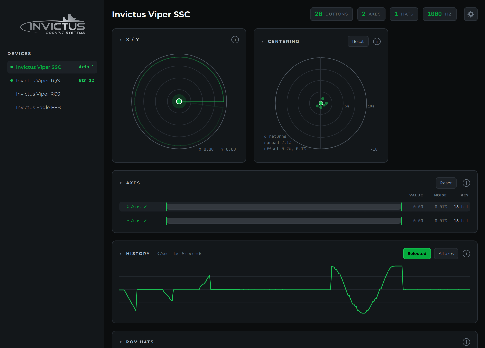

# AIM Joystick Probe

A modern, free joystick tester for Windows that shows **every** button on your
controller, including all **128 buttons** on AIM Ghost Joysticks that Windows'
built-in tester can't display.

## Why it exists

Windows' built-in game-controller panel caps the button display at **32**. AIM
Ghost Joysticks expose **128 buttons**, so most of them are invisible there. AIM
Joystick Probe reads the controller directly and shows every button, axis, and
POV hat at once.

## Download

Get the latest **AIM-Joystick-Probe-Setup.exe** from the
[**Releases**](https://github.com/invictuscockpits/aim-joystick-probe-releases/releases)
page.

The installer and the app are code-signed by Invictus Machine LLC, so Windows
installs them without flagging an unknown publisher. It installs **per-user, with no
administrator rights required**. There's a step-by-step install guide in the
[Wiki](https://github.com/invictuscockpits/aim-joystick-probe-releases/wiki/Getting-Started).

## Features

- **Full button map:** all 128 buttons, live, with no 32-button cap
- **Activity on every device:** touch any controller and its row in the sidebar
  lights up, so you can tell which device a control belongs to
- **Axis quality:** travel and full range, noise, effective resolution, and a
  5-second history graph, with the axis names the device reports
- **Stick tools:** an X / Y trail for gate shape and full throw, and a
  Centering card that measures how consistently the stick returns to center
- **Event log** with **switch bounce** detection
- **Test-All mode** for buttons and axes, to confirm every control on a
  freshly built panel
- **Report rate** in Hz for each device
- **Force feedback test** for FFB sticks (experimental)
- **Save snapshot** and **Copy diagnostics** for support requests
- **AIM Ghost control labels:** buttons on an AIM Ghost Joystick show the F-16
  cockpit control they're mapped to
- **Settings** to choose what's on screen, **collapsible cards**, and
  **always on top**
- **Automatic update check** with an in-app banner when a newer version is available

## Documentation

The full guide lives in the
[**Wiki**](https://github.com/invictuscockpits/aim-joystick-probe-releases/wiki).

## Support

- **Questions or bugs:** open an
  [issue](https://github.com/invictuscockpits/aim-joystick-probe-releases/issues).
- **Updates:** the app checks for a newer version on launch; you can also watch
  this repository's Releases.

## License

AIM Joystick Probe is **free to use**, for personal or commercial purposes. You
may share and redistribute unmodified copies free of charge, including with your
customers. It is proprietary software: it may not be sold, modified,
reverse-engineered or rebranded. The full terms are in the license agreement
the installer shows (EULA.txt in the installation folder).

---

© 2026 Invictus Machine LLC, doing business as Invictus Cockpit Systems
